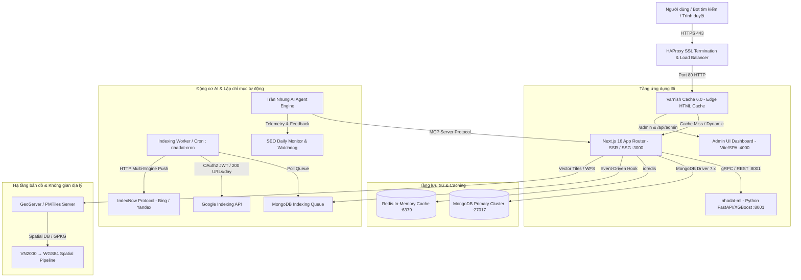

# SDD 00: Tổng Quan Kiến Trúc Hệ Thống (System Overview & Topology)

## 1. Giới thiệu dự án
`nhadat.city` là nền tảng công nghệ bất động sản (PropTech) thế hệ mới, tích hợp bản đồ quy hoạch không gian địa lý (GIS), định giá AI tự động, hệ thống Programmatic SEO quy mô toàn quốc (63 tỉnh/thành & ~10,000 phường/xã) và động cơ lập chỉ mục tức thì (Instant Indexing Engine).

---

## 2. Bản đồ kiến trúc hệ thống (System Topology)

---

## 3. Các phân hệ chính (Core Subsystems)

| Phân hệ | Công nghệ | Nhiệm vụ cốt lõi | Tài liệu chi tiết |
|---|---|---|---|
| **Web Core & SEO** | Next.js 16 (React 19), Tailwind CSS 4, Lucide Icons | SSR/SSG 63 tỉnh thành, phường xã, dự án, tin đăng, Schema.org JSON-LD | [`02_PROGRAMMATIC_SEO_AND_ROUTING_SDD.md`](docs/sdd/02_PROGRAMMATIC_SEO_AND_ROUTING_SDD.md) |
| **Data Layer** | MongoDB 7.x, Redis 7.x | Quản lý tin đăng BĐS, dự án, quy hoạch, người dùng, hàng đợi indexing | [`01_DATA_SCHEMA_AND_MODELS_SDD.md`](docs/sdd/01_DATA_SCHEMA_AND_MODELS_SDD.md) |
| **Instant Indexing** | Node.js, Google Indexing API, IndexNow | Lập chỉ mục tức thì ngay khi đăng/sửa/xóa tin, quản lý hạn ngạch 200/ngày | [`03_INSTANT_INDEXING_ENGINE_SDD.md`](docs/sdd/03_INSTANT_INDEXING_ENGINE_SDD.md) |
| **GIS & Planning** | MapLibre GL JS, PMTiles, GeoServer, Proj4 (VN2000) | Tra cứu quy hoạch, ranh thửa đất, hiển thị lớp phân khu toàn quốc | [`04_GIS_SPATIAL_AND_PLANNING_SDD.md`](docs/sdd/04_GIS_SPATIAL_AND_PLANNING_SDD.md) |
| **AI Agent Trần Nhung** | Node.js, Vercel AI SDK, MCP Server, Memory Graph | Tác tử tự hành giám sát SEO, tương tác liên cụm, tự động tối ưu hóa | [`05_AI_AGENT_FEDERATION_SDD.md`](docs/sdd/05_AI_AGENT_FEDERATION_SDD.md) |
| **Infrastructure** | HAProxy, Varnish 6.0, PM2, Kubernetes, Docker | Cân bằng tải, caching HTML SSR, zero-downtime deployment | [`06_INFRASTRUCTURE_AND_DEPLOYMENT_SDD.md`](docs/sdd/06_INFRASTRUCTURE_AND_DEPLOYMENT_SDD.md) |
| **Codemap & Layout** | TypeScript, Next.js App Router Structure | Bản đồ cấu trúc thư mục, luồng module, hợp đồng interface giữa các tầng | [`07_CODEBASE_AND_CODEMAP_SDD.md`](docs/sdd/07_CODEBASE_AND_CODEMAP_SDD.md) |

---

## 4. Nguyên tắc kiến trúc (Architectural Invariants)

1. **Single Source of Truth (SSOT)**: Mọi định nghĩa schema, hằng số cấu hình, danh mục 63 tỉnh thành chỉ định nghĩa duy nhất tại `lib/`.
2. **Strict Error Handling & Observability**: Không nuốt lỗi (`catch(_e){}`), mọi log đều có tiền tố module chuẩn `[ModuleName]`.
3. **Timeout Enforcement**: Toàn bộ thao tác mạng, fetch, subprocess, DB query đều bọc timeout bắt buộc.
4. **No Fake / Mock Data**: Dữ liệu đo đạc và telemetry phản ánh 100% hiện trạng thực tế từ hạ tầng.
5. **Clean & High-End UX**: Không dùng emoji unicode trong UI/headings; tuân thủ ngữ pháp tiếng Việt Sentence Case.
