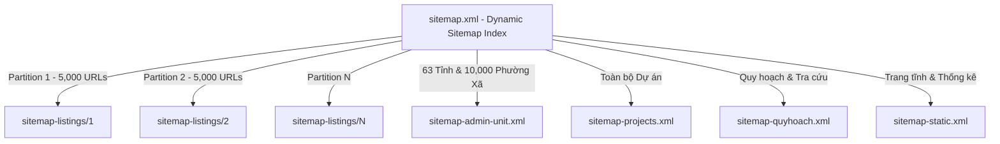

# SDD 02: Định Tuyến Programmatic SEO & Cấu Trúc Dữ Liệu Schema.org

## 1. Cây Phân Cấp Định Tuyến (URL Taxonomy & Routing)

Hệ thống định tuyến của `nhadat.city` được thiết kế theo mô hình Programmatic SEO 4 cấp, tối đa hóa mật độ từ khóa tìm kiếm tự nhiên của người dùng và tối ưu crawl budget của Search Engines:

```
https://nhadat.city/
├── [province]/                              # Cấp 1: 63 Tỉnh/Thành phố (VD: /ha-noi, /ho-chi-minh)
│   └── [ward]/                              # Cấp 2: Phường/Xã trực thuộc (VD: /ha-noi/phuong-hang-bac)
│       └── [id]/[slug]                      # Cấp 3: Chi tiết tin đăng BĐS (VD: /ha-noi/phuong-hang-bac/65a.../ban-nha-mat-pho)
├── du-an/                                   # Danh mục dự án toàn quốc
│   └── [id]/[slug]                          # Chi tiết dự án với shortId trực tiếp
├── quy-hoach/                               # Bản đồ tra cứu quy hoạch đất đai
│   └── [province]/                          # Bản đồ quy hoạch theo tỉnh thành
├── thong-ke/                                # Báo cáo phân tích dữ liệu thị trường & biến động giá
├── tu-khoa/[slug]                           # Landing page từ khóa ngách có nhu cầu tìm kiếm cao
└── sitemap.xml                              # Dynamic Sitemap Index
```

---

## 2. Kiến Trúc Sitemap Động Đa Phân Vùng (Dynamic Partitioned Sitemaps)

Để xử lý hàng trăm nghìn tin đăng bất động sản mà không vượt quá giới hạn 50,000 URLs / 50MB của chuẩn Sitemaps XML:



### Quy tắc tính toán phân vùng:
- Mỗi phân vùng chứa tối đa **5,000 items** (`CHUNK_SIZE = 5000`).
- Số lượng phân vùng `totalPages = Math.ceil(totalActiveListings / CHUNK_SIZE)`.
- Các trang trống (vượt quá `totalPages`) trả về `<urlset>` rỗng hợp lệ với HTTP 200, không bao giờ gây lỗi 500.

---

## 3. Cấu Trúc Dữ Liệu Có Cấu Trúc Schema.org (JSON-LD)

Mỗi trang chi tiết và trang danh mục tự động nhúng các khối JSON-LD chuẩn SEO Entity:

### 3.1 `RealEstateListing` & `SingleFamilyResidence` / `ApartmentComplex`
```json
{
  "@context": "https://schema.org",
  "@type": "RealEstateListing",
  "name": "Bán nhà mặt phố Hàng Bạc, Hoàn Kiếm, diện tích 85m²",
  "url": "https://nhadat.city/ha-noi/phuong-hang-bac/65a.../ban-nha-mat-pho",
  "datePosted": "2026-09-01T08:00:00Z",
  "mainEntity": {
    "@type": "SingleFamilyResidence",
    "name": "Nhà mặt phố Hàng Bạc",
    "address": {
      "@type": "PostalAddress",
      "addressLocality": "Phường Hàng Bạc",
      "addressRegion": "Hà Nội",
      "addressCountry": "VN"
    },
    "geo": {
      "@type": "GeoCoordinates",
      "latitude": 21.0345,
      "longitude": 105.8521
    },
    "offers": {
      "@type": "Offer",
      "price": 25000000000,
      "priceCurrency": "VND",
      "availability": "https://schema.org/InStock"
    }
  }
}
```

### 3.2 `BreadcrumbList` & `FAQPage`
- **BreadcrumbList**: Tự động phản ánh đúng cây phả hệ: Trang chủ -> Tỉnh/Thành -> Phường/Xã -> Tin chi tiết.
- **FAQPage**: Tạo 4 câu hỏi thường gặp liên quan đến pháp lý, định giá, quy hoạch và ngân hàng vay vốn cho từng tin đăng.

---

## 4. Tiêu Chuẩn Ngữ Pháp Tiếng Việt & Thiết Kế Giao Diện

1. **Sentence Case bắt buộc**:
   - ✅ *Mua bán nhà đất Hà Nội giá rẻ, sổ đỏ chính chủ*
   - ❌ *MUA BÁN NHÀ ĐẤT HÀ NỘI GIÁ RẺ* (ALL CAPS)
   - ❌ *Mua Bán Nhà Đất Hà Nội Giá Rẻ* (Title Case kiểu tiếng Anh)
2. **Loại bỏ 100% Emoji Unicode**:
   - Sử dụng thư viện `lucide-react` với SVG vector mảnh, hiện đại (16px - 18px).
   - Tuyệt đối không chèn emoji (🏠, 🚀, 📍, 🔥) vào thẻ H1, H2, Title, Meta Description hay Breadcrumbs.
