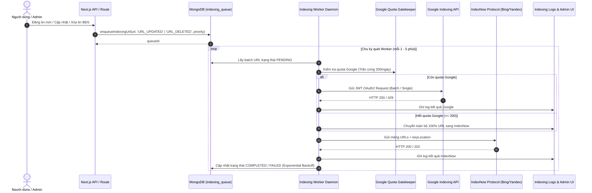

# SDD 03: Động Cơ Lập Chỉ Mục Tức Thì (Instant Indexing Engine)

## 1. Giới thiệu
Instant Indexing Engine của `nhadat.city` kết hợp 2 giao thức lập chỉ mục tự động thời gian thực hàng đầu thế giới:
1. **Google Indexing API**: Thông báo thay đổi URL (URL_UPDATED / URL_DELETED) trực tiếp tới Googlebot qua Service Account OAuth2 JWT.
2. **IndexNow Protocol**: Phát tín hiệu đồng thời tới Bing, Yandex, Seznam và toàn bộ mạng lưới IndexNow.org.

---

## 2. Kiến Trúc Luồng Sự Kiện (Event-Driven Pipeline)



---

## 3. Các Hợp Đồng Interface Cốt Lõi (`lib/indexing/indexingEngine.ts`)

```typescript
/**
 * Thêm URL vào hàng đợi lập chỉ mục
 */
export async function enqueueIndexingUrl(
  url: string,
  type: 'URL_UPDATED' | 'URL_DELETED' = 'URL_UPDATED',
  priority: number = 5,
  source: string = 'system'
): Promise<{ success: boolean; queueId?: string; message?: string }>;

/**
 * Xử lý lô hàng đợi lập chỉ mục
 */
export async function processIndexingQueue(
  batchSize: number = 20
): Promise<{
  processed: number;
  googleCount: number;
  indexNowCount: number;
  errors: any[];
}>;

/**
 * Lấy trạng thái hạn ngạch (quota) hôm nay
 */
export async function getIndexingQuotaStatus(): Promise<{
  googleUsedToday: number;
  googleQuotaRemaining: number;
  queuePendingCount: number;
  totalProcessed24h: number;
}>;
```

---

## 4. Cơ Chế Thử Lại & Quản Lý Lỗi (Exponential Backoff)

- **Chiến lược Backoff**:
  $$\text{delaySeconds} = \min(3600, 60 \times 2^{\text{retryCount}})$$
- **Giới hạn số lần thử lại**: Tối đa 5 lần trước khi chuyển sang trạng thái `FAILED`.
- **Tự phục hồi**: Nếu Google Indexing API trả về mã lỗi 429 (Rate Limit Exceeded), hệ thống tự động giãn chu kỳ và chuyển ưu tiên sang IndexNow.

---

## 5. Xác Thực Khóa Công Khai IndexNow (Public Key Verification)

1. Tệp tĩnh: `/public/e89c09ce31c045b791483dc4e9a59313.txt`
2. Endpoint động: `https://nhadat.city/e89c09ce31c045b791483dc4e9a59313.txt` trả về đúng chuỗi 32 ký tự hex với Content-Type `text/plain`.
