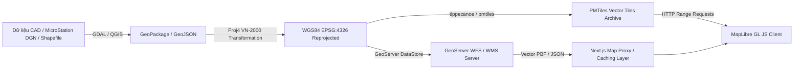

# SDD 04: Hạ Tầng GIS, Bản Đồ Quy Hoạch & Ranh Thửa Đất

## 1. Giới Thiệu Phân Hệ Không Gian Địa Lý
Phân hệ GIS của `nhadat.city` cho phép người dùng tra cứu bản đồ quy hoạch xây dựng, ranh giới hành chính và thông tin ranh thửa đất với độ chính xác cao dựa trên hệ tọa độ chuẩn quốc gia VN2000 và chuẩn toàn cầu WGS84 (EPSG:4326 / EPSG:3857).

---

## 2. Đường Ống Xử Lý Dữ Liệu Không Gian (Spatial Data Pipeline)

---

## 3. Hệ Thống Chuyển Đổi Tọa Độ VN2000 (`lib/geo/vn2000.ts`)

Mỗi tỉnh thành tại Việt Nam sử dụng kinh tuyến trục riêng biệt (Central Meridian) với múi chiếu 3 độ hoặc 6 độ:

| Tỉnh / Thành phố | Kinh tuyến trục (Central Meridian) | EPSG Nội bộ |
|---|---|---|
| Hà Nội | 105.0° | VN2000_HaNoi_3deg |
| TP. Hồ Chí Minh | 105.75° | VN2000_HCM_3deg |
| Đà Nẵng | 107.75° | VN2000_DaNang_3deg |
| Hải Phòng | 105.75° | VN2000_HaiPhong_3deg |
| Cần Thơ | 105.0° | VN2000_CanTho_3deg |

Module `vn2000.ts` sử dụng thư viện `proj4` được cấu hình sẵn 63 bộ tham số dịch chuyển 7 tham số (7-parameter Helmert transformation) để chuyển đổi qua lại giữa VN2000 (X, Y) và WGS84 (Lat, Lng) với sai số dưới 0.1m.

---

## 4. Kiến Trúc Caching & Phân Phối Lớp Bản Đồ

1. **PMTiles (Cloud-Optimized Vector Tiles)**:
   - Các lớp phân khu quy hoạch lớn (Hà Nội, TP.HCM) được đóng gói dưới định dạng PMTiles duy nhất.
   - Trình duyệt MapLibre GL JS chỉ cần tải đúng các byte-range tương ứng với vùng nhìn (Bounding Box & Zoom level 12-16) qua HTTP Range Request.
2. **Proxy Bảo Vệ & Rate Limiting (`lib/middleware/mapToken.ts`)**:
   - Toàn bộ request tải tile hoặc truy vấn WFS thửa đất đi qua proxy nội bộ `/api/map/*` với token mã hóa thời hạn ngắn (TTL 300s) để ngăn chặn việc đánh cắp hoặc crawl hàng loạt dữ liệu bản đồ.
