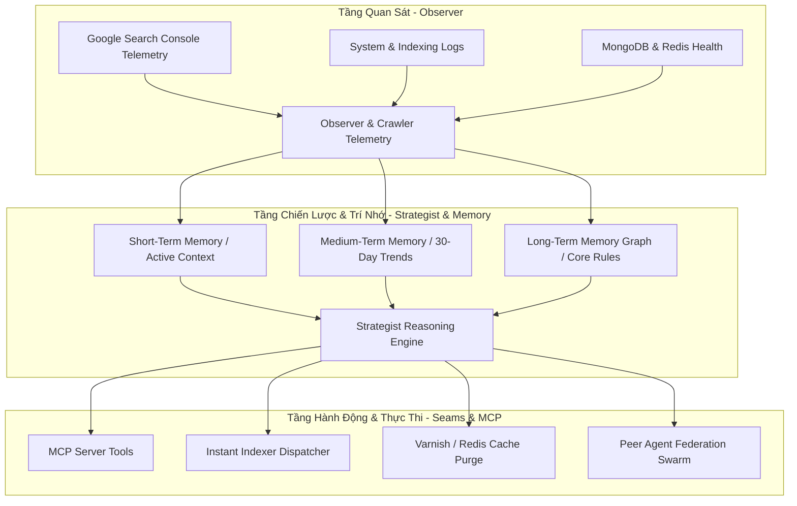

# SDD 05: Kiến Trúc Tác Tử Tự Hành Trần Nhung & Federation (AI Agent Architecture)

## 1. Giới Thiệu
Trần Nhung AI Agent là tác tử trí tuệ nhân tạo tự hành chuyên trách giám sát, vận hành, phân tích SEO và tối ưu hóa hệ thống `nhadat.city`. Agent hoạt động theo mô hình khép kín (Autonomous Perception-Action Loop) và hỗ trợ giao thức MCP (Model Context Protocol).

---

## 2. Mô Hình Nhận Thức & Hành Động 3 Tầng (Cognitive Tri-Tier Loop)

---

## 3. Kiến Trúc Bộ Nhớ 3 Tầng (Tri-Tier Memory Architecture)

1. **Short-Term Memory (Bộ nhớ ngắn hạn)**:
   - Lưu trữ context phiên làm việc hiện tại, các cảnh báo tức thời, trạng thái crawl 24h qua.
2. **Medium-Term Memory (Bộ nhớ trung hạn)**:
   - Bảng tổng hợp xu hướng từ khóa, vị trí xếp hạng trung bình (Position), CTR và biến động traffic theo chu kỳ tuần/tháng trong `seo-reports/*.json`.
3. **Long-Term Memory Graph (Đồ thị tri thức dài hạn)**:
   - Lưu trữ các quyết định kiến trúc, quy tắc cấm (Zero Unicode Emoji, Vietnamese Sentence Case, Single Source of Truth), mối quan hệ giữa các thực thể và lịch sử sự cố (Post-Mortem / RCA).

---

## 4. Giao Thức MCP Server & Communication Seams

Trần Nhung AI Agent cung cấp máy chủ MCP (`mcpServer.js`) cho phép các tác tử khác trong cụm (như Antigravity hoặc Peer Subagents) gọi các công cụ quản trị hệ thống:
- `nhadat_get_indexing_status`: Truy vấn hạn ngạch Google Indexing API và hàng đợi.
- `nhadat_submit_instant_indexing`: Kích hoạt lập chỉ mục tức thì cho danh sách URLs.
- `nhadat_get_seo_overview`: Lấy báo cáo phân tích hiệu năng SEO tổng thể.
- `nhadat_purge_edge_cache`: Xóa cache Varnish theo URL pattern hoặc tag.
- `nhadat_sync_admin_units`: Đồng bộ cây phả hệ 63 tỉnh/thành và phường/xã.
