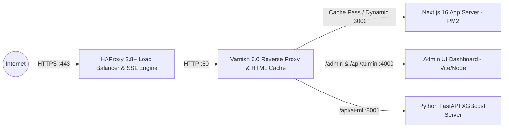

# SDD 06: Hạ Tầng, Cân Bằng Tải & Triển Khai (Infrastructure & Deployment)

## 1. Kiến Trúc Mạng & Cân Bằng Tải (Network & Ingress Topology)

Hạ tầng `nhadat.city` được triển khai với mô hình phòng thủ theo chiều sâu (Defense in Depth) và tối ưu hóa phản hồi thời gian thực:

---

## 2. Chiến Lược Caching Cạnh Mạng Varnish VCL (`infra/varnish/default.vcl`)

1. **Quy tắc Caching HTML SSR**:
   - Trang chi tiết tin đăng (`/[province]/[ward]/[id]/[slug]`): Cache **1 giờ** (`TTL = 3600s`), Grace period **6 giờ**.
   - Trang danh mục tỉnh/phường (`/[province]`, `/[province]/[ward]`): Cache **30 phút** (`TTL = 1800s`).
   - Sitemaps XML (`/sitemap.xml`, `/sitemap-listings/*`): Cache **4 giờ** (`TTL = 14400s`).
2. **Quy tắc Bypass Cache (Pass-Through)**:
   - Tất cả request chứa cookie phiên đăng nhập quản trị `admin_session_token` hoặc Authorization Bearer header.
   - Các API tương tác trực tiếp (`/api/chat/*`, `/api/admin/*`, `/api/user/*`).
3. **Cơ Chế Xóa Cache Tức Thì (HTTP PURGE)**:
   - Server Next.js phát request `PURGE /ha-noi/phuong-hang-bac/...` với header `X-Purge-Key` được bảo vệ tới Varnish mỗi khi tin đăng được chỉnh sửa hoặc xóa.

---

## 3. Quản Lý Tiến Trình PM2 Zero-Downtime (`ecosystem.config.js`)

| Tên tiến trình | Cổng lắng nghe | Môi trường / Interpreter | Chức năng |
|---|---|---|---|
| `nhadat-next` | `3000` | Node.js 20+ / Next.js Start | Web Core SSR, SSG, Public API |
| `nhadat-admin` | `4000` | Node.js Express / Vite Dist | Dashboard Quản Trị Hệ Thống |
| `nhadat-cron` | Background | Node.js (`scripts/scraper/cron.js`) | Cron Scraper, Indexing Worker |
| `nhadat-ml` | `8001` | Python venv / Uvicorn | API Định Giá & Gợi Ý AI |

---

## 4. Kiến Trúc Triển Khai Proxmox LXC & PM2 Cluster

Hệ thống được chuẩn hóa chạy trực tiếp trên **Proxmox VE LXC Container** để tối đa hóa hiệu năng I/O mạng và CPU thô, loại bỏ hoàn toàn độ trễ ảo hóa và overhead của Kubernetes:

- **LXC Container Runtime**:
  - Tận dụng chia sẻ Linux Kernel trực tiếp của Proxmox Host, không tốn RAM overhead cho nhiều VM K8s.
  - Tối ưu hóa throughput cho HAProxy SSL Termination và Varnish Edge Cache.
- **Tiến trình Ứng dụng (PM2 Process Manager)**:
  - `nhadat-next`: Node.js 20+ chạy qua PM2, tự động restart khi có sự cố.
  - `nhadat-admin`: Express/Vite Admin Dashboard phục vụ quản trị.
  - `nhadat-cron`: Tác vụ cào dữ liệu và đồng bộ chỉ mục chạy nền.
  - `nhadat-ml`: Python FastAPI ML Service phục vụ định giá và phân tích bất động sản.
- **Lưu trữ & Dữ liệu**:
  - MongoDB & Redis kết nối trực tiếp qua mạng nội bộ Proxmox SDN / Bridge.
  - Tối ưu hóa ZFS / NVMe I/O trực tiếp trên LXC.
