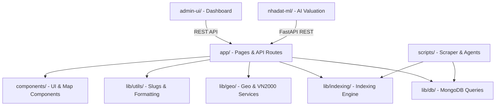

# SDD 07: Bản Đồ Mã Nguồn & Cấu Trúc Dự Án (Codebase Map & Layout)

## 1. Cấu Trúc Tổng Thể Dự Án (Workspace Root Structure)

```
nhadat-next/
├── app/                                     # Next.js 16 App Router (Core Web & API Routes)
│   ├── layout.tsx                           # Root Layout, Global CSS, Metadata & SEO Footer
│   ├── page.tsx                             # Trang chủ SSR với Schema RealEstateAgent
│   ├── robots.ts                            # robots.txt động với bộ lọc Bot & Crawl Traps
│   ├── sitemap.xml/route.ts                 # Dynamic Sitemap Index
│   ├── sitemap-listings/[page]/route.ts     # Phân vùng sitemap tin đăng (5,000 URLs/partition)
│   ├── sitemap-admin-unit.xml/route.ts      # Sitemap 63 tỉnh/thành & ~10,000 phường/xã
│   ├── [province]/                          # Cấp 1: Landing page 63 Tỉnh/Thành
│   │   └── [ward]/                          # Cấp 2: Landing page Phường/Xã
│   │       └── [id]/[slug]/page.tsx         # Cấp 3: Chi tiết tin đăng BĐS (SSR + Schema JSON-LD)
│   ├── du-an/                               # Danh mục & Chi tiết dự án bất động sản
│   ├── quy-hoach/                           # Tra cứu bản đồ quy hoạch đất đai
│   ├── thong-ke/                            # Báo cáo thống kê giá & thị trường (Direct DB)
│   ├── tu-khoa/[slug]/page.tsx              # Landing page từ khóa ngách
│   └── api/                                 # Hệ thống API Endpoints
│       ├── admin/                           # API Quản trị (Auth, Indexing, Logs, Map Layers)
│       ├── chat/                            # API Trợ lý tư vấn AI
│       └── map/                             # Proxy phân phối Vector Tiles & WFS bảo mật
├── components/                              # React 19 UI Components
│   ├── Header.tsx                           # Thanh điều hướng chính (Lucide Icons)
│   ├── SeoFooter.tsx                        # Chân trang SEO liên kết ma trận 63 tỉnh thành
│   ├── ListingDetail/                       # Các khối nội dung chi tiết tin đăng BĐS
│   ├── Map/                                 # Trình hiển thị bản đồ MapLibre GL JS
│   └── ui/                                  # Bộ thành phần giao diện dùng chung
├── lib/                                     # Thư viện logic lõi (Single Source of Truth)
│   ├── ai/                                  # Định tuyến mô hình AI, Tools & Prompt System
│   ├── config/                              # Cấu hình máy chủ, CDN, hình ảnh
│   ├── db/                                  # Kết nối MongoDB, queries realEstate, projects, statistics
│   ├── geo/                                 # Chuyển đổi tọa độ VN2000 ↔ WGS84, phân giải địa giới
│   ├── indexing/                            # Google Indexing API, IndexNow, Queue Worker
│   ├── map/                                 # Tiện ích bản đồ, token giải mã PMTiles
│   └── utils/                               # Chuẩn hóa chuỗi slug, obfuscator, bộ nhớ đệm
├── infra/                                   # Cấu hình hạ tầng, cân bằng tải & cache
│   ├── haproxy/                             # HAProxy SSL Termination & Load Balancer
│   ├── varnish/                             # Varnish VCL Edge Caching
│   └── scripts/                             # Kịch bản triển khai hạ tầng an toàn
├── admin-ui/                                # Giao diện Dashboard quản trị độc lập (Vite/React)
├── nhadat-ml/                               # Dịch vụ định giá AI & Recommender (Python FastAPI/XGBoost)
├── scripts/                                 # Công cụ vận hành, scraper & AI Agent Trần Nhung
│   ├── db_maintenance/                      # Bảo trì chỉ mục DB & dọn dẹp trùng lặp
│   ├── scraper/                             # Động cơ thu thập & cập nhật dữ liệu tự động
│   ├── seo-monitor/                         # Giám sát vị trí từ khóa & telemetry hàng ngày
│   └── tran-nhung-agent/                    # Tác tử AI tự hành Trần Nhung & MCP Server
├── tests/                                   # Bộ kiểm thử tự động toàn diện (E2E, Adversarial SEO)
├── docs/                                    # Tài liệu thiết kế đặc tả kỹ thuật (SDD Suite)
│   └── sdd/                                 # Bộ tài liệu chuẩn SDD từ 00 đến 07
├── ecosystem.config.js                      # Cấu hình quản lý tiến trình PM2 Zero-Downtime
├── next.config.js                           # Cấu hình Next.js 16
└── package.json                             # Khai báo dependencies & scripts
```

---

## 2. Ma Trận Quan Hệ Phụ Thuộc Module (Module Dependency Matrix)



---

## 3. Quy Ước Đặt Tên & Tổ Chức Mã Nguồn

1. **Thư mục & Tệp tin**:
   - React Components: PascalCase (ví dụ: `SeoFooter.tsx`, `ListingDetailContent.tsx`).
   - Hooks & Utilities: camelCase (ví dụ: `useMapLayer.ts`, `idObfuscator.ts`, `geoService.ts`).
   - Next.js Routes: kebab-case hoặc dynamic parameter `[param]`.
2. **Import Paths**:
   - Bắt buộc dùng alias `@/` thay vì relative path dài dòng `../../../../lib/db/mongodb`.
   - Ví dụ: `import { getDb } from '@/lib/db/mongodb';`
3. **Log Standards**:
   - Luôn kèm module prefix: `console.log('[IndexingEngine] Processed 20 URLs successfully')`.
   - Lỗi: `console.error('[GeoService Error] Failed to parse VN2000 coordinates', err)`.
